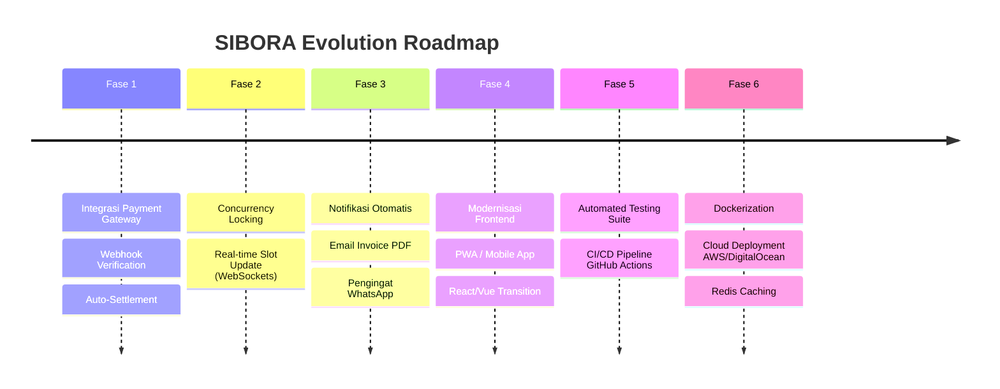

# 🗺️ SIBORA — Development Roadmap & Extension Guide

Dokumen ini merupakan panduan strategis dan teknis bagi pengembang yang ingin **melanjutkan atau meningkatkan** proyek **SIBORA (Sistem Booking Fasilitas Olahraga Online)** di masa mendatang. 

Arsitektur SIBORA dirancang modular dengan standar RESTful API Laravel 12 dan frontend yang terisolasi, sehingga memudahkan penambahan fitur baru tanpa merusak fungsi yang sudah ada.

---

## 📌 Status Pengembangan Saat Ini (v1.0.0)

| Modul | Status | Keterangan |
|---|---|---|
| **Katalog Lapangan & Peralatan** | ✅ Selesai | Filter cabang olahraga, fasilitas, slot jam, detail aset |
| **Autentikasi & RBAC Multi-Peran** | ✅ Selesai | Laravel Sanctum token, peran `pelanggan`, `pengelola`, `admin` |
| **Sistem Booking & Sewa Alat** | ✅ Selesai | Reservasi slot waktu dinamis, kalkulasi biaya admin otomatis |
| **Dashboard Pengelola & Admin** | ✅ Selesai | CRUD aset, upload foto, pemantauan transaksi, ringkasan pendapatan |
| **Simulasi Pembayaran (Demo)** | ✅ Selesai | Mock payment multi-channel lokal untuk pengujian transaksi |
| **Riwayat & Struk Digital** | ✅ Selesai | Cetak bukti reservasi berbasis browser |

---

## 🚀 Rencana Fase Pengembangan Lanjutan



---

### 💳 Fase 1: Integrasi Payment Gateway Resmi (Midtrans / Xendit)

**Tujuan:** Mengganti alur mock payment lokal menjadi pembayaran digital sungguhan (QRIS, GoPay, OVO, ShopeePay, Virtual Account Bank, dan Kartu Kredit).

#### Langkah Implementasi Teknis:
1. **Pemasangan SDK Provider**:
   ```bash
   cd backend-laravel
   composer require midtrans/midtrans-php
   ```
2. **Konfigurasi Environment**:
   Tambahkan variabel pada `.env`:
   ```dotenv
   MIDTRANS_SERVER_KEY=SB-Mid-server-xxxxxxxxxxxx
   MIDTRANS_CLIENT_KEY=SB-Mid-client-xxxxxxxxxxxx
   MIDTRANS_IS_PRODUCTION=false
   ```
3. **Refactor Service Pembayaran**:
   - Modifikasi `app/Http/Controllers/PaymentController.php`: ganti `store()` untuk memanggil API Snap Midtrans dan menghasilkan `snap_token` serta `redirect_url`.
   - Implementasikan verifikasi signature SHA512 pada method `webhook()` untuk menjamin keamanan notifikasi HTTP dari payment gateway:
     ```php
     $signatureKey = hash('sha512', $orderId . $statusCode . $grossAmount . config('services.midtrans.server_key'));
     if ($signatureKey !== $request->signature_key) {
         return response()->json(['message' => 'Invalid signature'], 403);
     }
     ```
4. **Sinkronisasi Status Transaksi**:
   - `settlement` / `capture` $\rightarrow$ Ubah status transaksi menjadi `lunas`, slot status `dipesan`.
   - `expire` / `cancel` $\rightarrow$ Ubah status transaksi menjadi `kedaluwarsa` / `batal`, kembalikan slot ke `tersedia`.

---

### ⚡ Fase 2: Concurrency Control & Real-time WebSockets

**Tujuan:** Mencegah terjadinya *race condition* (dua pengguna memesan slot lapangan yang sama pada detik yang bersamaan) dan menampilkan ketersediaan slot secara live tanpa refresh halaman.

#### Langkah Implementasi Teknis:
1. **Pessimistic Locking pada Database**:
   Di `app/Http/Controllers/BookingController.php`, bungkus pengecekan dan reservasi ke dalam transaksi database dengan `lockForUpdate()`:
   ```php
   DB::transaction(function () use ($lapanganId, $tanggal, $jamMulai, $jamSelesai) {
       $isBooked = JadwalSlot::where('lapangan_id', $lapanganId)
           ->where('tanggal', $tanggal)
           ->where('jam_mulai', $jamMulai)
           ->lockForUpdate()
           ->where('status', 'dipesan')
           ->exists();

       if ($isBooked) {
           throw new \Exception('Slot waktu baru saja dipesan oleh pengguna lain.');
       }
       // Lanjutkan pembuatan booking...
   });
   ```
2. **Real-time Event Broadcasting**:
   - Gunakan **Laravel Reverb** (bawaan Laravel 11+) atau **Pusher**:
     ```bash
     php artisan install:broadcasting
     ```
   - Buat event `SlotStatusChanged`:
     ```php
     broadcast(new SlotStatusChanged($lapanganId, $tanggal, $slotId, 'dipesan'))->toOthers();
     ```
   - Di sisi frontend (`public/js/`), pasang `laravel-echo` untuk mendengarkan perubahan status slot dan langsung memberi warna abu-abu (terisi) secara instan.

---

### 📩 Fase 3: Notifikasi Otomatis & Tiket PDF

**Tujuan:** Memberikan konfirmasi pemesanan resmi yang elegan kepada pelanggan dan notifikasi pesanan masuk kepada pengelola.

#### Langkah Implementasi Teknis:
1. **Email Konfirmasi dengan PDF Invoice**:
   - Pemasangan PDF generator:
     ```bash
     composer require barryvdh/laravel-dompdf
     ```
   - Buat Mailable:
     ```bash
     php artisan make:mail BookingSuccessMail --markdown=emails.bookings.success
     ```
   - Lampirkan struk PDF yang berisi QR Code unik (menggunakan `simplesoftwareio/simple-qrcode`) untuk check-in di lokasi lapangan.
2. **Notifikasi WhatsApp**:
   - Integrasikan gateway WhatsApp (misal: Fonnte, Wablas, atau Twilio).
   - Kirim pesan pengingat jadwal 2 jam sebelum pertandingan dimulai:
     *"Halo [Nama], pertandingan Anda di [Nama Lapangan] akan dimulai pukul [Jam Mulai]. Tunjukkan kode booking ini saat check-in: [KODE_BOOKING]"*.

---

### 📱 Fase 4: Frontend Modernization & Mobile App

**Tujuan:** Meningkatkan pengalaman pengguna di perangkat seluler dan performa halaman web.

#### Opsi 1: PWA (Progressive Web App)
- Tambahkan `manifest.json` dan `sw.js` (Service Worker) pada `backend-laravel/public/`.
- Memungkinkan aplikasi di-"Install" langsung ke layar utama smartphone Android/iOS tanpa melalui Play Store.
- Menyediakan caching offline untuk data profil dan riwayat reservasi yang sudah diunduh.

#### Opsi 2: Aplikasi Mobile Native / Cross-Platform (Flutter / React Native)
- Seluruh endpoint API di `routes/api.php` sudah mengikuti format JSON standar dan terproteksi Sanctum Bearer Token.
- Mobile developer dapat langsung menghubungkan aplikasi Android/iOS ke API SIBORA tanpa perlu mengubah backend sama sekali.

#### Opsi 3: Transisi ke Frontend Modern (Vue 3 / React + Tailwind CSS)
- Bila tim ingin beralih dari Vanilla JS ke SPA modern:
  - Bangun frontend terpisah menggunakan **Vite + React / Vue 3**.
  - Letakkan di folder `frontend/` di root proyek.
  - Hubungkan via Axios ke `http://127.0.0.1:8000/api/v1`.

---

### 🧪 Fase 5: Automated Testing Suite & CI/CD

**Tujuan:** Memastikan setiap perubahan kode tidak merusak fitur lama (*regression testing*).

#### Langkah Implementasi:
1. **Feature Tests dengan PHPUnit / Pest**:
   - Tambahkan test cases di `backend-laravel/tests/Feature/`:
     - `AuthTest.php`: Memastikan login, registrasi, validasi format email, dan hashing password bekerja benar.
     - `BookingTest.php`: Menguji booking berhasil, deteksi bentrok jam, dan pembatalan transaksi.
     - `RevenueTest.php`: Memastikan kalkulasi bagi hasil pengelola dan potongan biaya admin tepat 100%.
2. **GitHub Actions Workflow**:
   - Buat file `.github/workflows/ci.yml` untuk menjalankan otomatis:
     - Dependency install (`composer install`)
     - Linter / Code Style Check
     - Database Migration & Unit Tests setiap ada push ke branch `main`.

---

### ☁️ Fase 6: Containerization & Deployment Produksi

**Tujuan:** Mempermudah deployment aplikasi ke VPS (Ubuntu / Debian), AWS EC2, atau DigitalOcean Droplet.

#### Blueprint Docker (`docker-compose.yml`):
- **Service Web/App**: PHP 8.2+ FPM + Nginx Alpine
- **Service Database**: MySQL 8.0 / MariaDB 10.11
- **Service Cache/Queue**: Redis Alpine (untuk session dan queue driver antrean email/webhook)

#### Checklist Keamanan Server Produksi:
- [ ] Ubah `APP_ENV=production` dan `APP_DEBUG=false` pada `.env`.
- [ ] Jalankan `php artisan config:cache`, `php artisan route:cache`, dan `php artisan view:cache`.
- [ ] Pasang SSL/TLS via Let's Encrypt / Certbot.
- [ ] Atur rate-limiting pada API (`throttle:60,1`).
- [ ] Amankan folder `public/uploads/` agar file PHP yang diunggah tidak dapat dieksekusi oleh server.

---

*Dengan panduan roadmap di atas, siapa pun Full Stack Engineer yang melanjutkan repositori ini dapat langsung mengeksekusi fitur-fitur skala enterprise dengan cepat dan terstruktur.* 🚀
