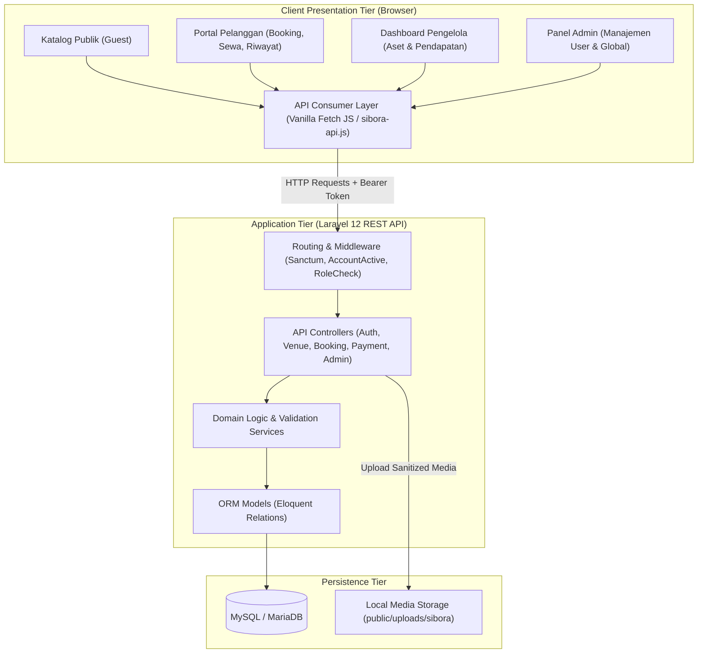
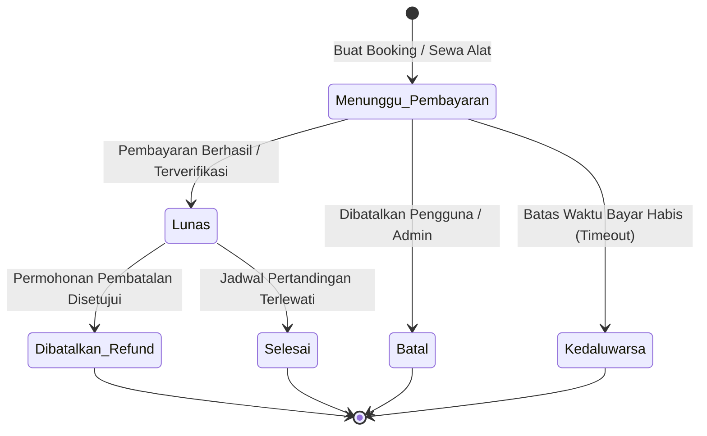

# 🏛️ SIBORA — System Architecture & Design Specification

Dokumen ini menjelaskan arsitektur sistem, desain komponen, manajemen hak akses berbasis peran (RBAC), alur siklus hidup transaksi, dan standar keamanan yang diterapkan pada **SIBORA (Sistem Booking Fasilitas Olahraga Online)**.

---

## 1. Ikhtisar Arsitektur Sistem

SIBORA dirancang menggunakan pola **Layered Client-Server Architecture** yang mengintegrasikan frontend berbasis antarmuka web modern dengan backend RESTful API berkinerja tinggi.

---

## 2. Role-Based Access Control (RBAC)

Sistem membedakan hak akses secara ketat berdasarkan atribut `role` pada tabel `users`. Setiap request API pada endpoint terlindungi melewati middleware `auth:sanctum` dan `account.active`.

### Matriks Otorisasi Fitur:

| Fitur / Modul | Guest (Publik) | Pelanggan | Pengelola | Admin |
|---|:---:|:---:|:---:|:---:|
| **Lihat Katalog Lapangan & Peralatan** | ✅ | ✅ | ✅ | ✅ |
| **Cek Jadwal & Slot Waktu** | ✅ | ✅ | ✅ | ✅ |
| **Registrasi & Login Akun** | ✅ | ✅ | ✅ | ✅ |
| **Booking Lapangan & Sewa Alat** | ❌ | ✅ | ❌ | ❌ |
| **Simulasi Pembayaran (Mock/Demo)** | ❌ | ✅ | ❌ | ❌ |
| **Lihat Riwayat & Cetak Struk** | ❌ | ✅ (Milik sendiri) | ❌ | ❌ |
| **Kelola Profil & Lapangan Favorit** | ❌ | ✅ | ✅ | ✅ |
| **Kelola Lapangan & Peralatan** | ❌ | ❌ | ✅ (Aset sendiri) | ✅ (Global) |
| **Lihat Laporan Pendapatan** | ❌ | ❌ | ✅ (Aset sendiri) | ✅ (Global) |
| **Manajemen Akun & Reset Password** | ❌ | ❌ | ❌ | ✅ |

> **Catatan Keamanan:** Pengelola dilarang keras melakukan booking lapangan untuk menjaga integritas data transaksi dan pemisahan wewenang bisnis. Pengelola hanya dapat mengelola jadwal operasional dan aset mereka.

---

## 3. Siklus Hidup Transaksi (Transaction Lifecycle)

Setiap proses reservasi lapangan atau penyewaan alat diproses melalui *State Machine* berikut:

### Logika Aturan Bisnis:
1. **Pemesanan Slot:** Saat transaksi berstatus `menunggu_pembayaran`, slot jadwal ditandai sementara dengan status reservasi.
2. **Kalkulasi Biaya Admin:** Biaya admin platform dihitung secara dinamis dari persentase subtotal (`SIBORA_ADMIN_FEE_PERCENT`, default: 5%).
3. **Pembayaran:**
   - Metode pembayaran yang didukung dalam skema: `bca`, `bni`, `qris`, `cash`, `transfer_bank`, dan `lainnya`.
   - Konfirmasi pembayaran otomatis mengupdate status transaksi ke `lunas` dan slot jadwal ke `dipesan`.
4. **Pembatalan & Refund:** Tercatat secara historis di tabel `pembatalan` beserta alasan pembatalan dan status refund (`tidak_berlaku`, `menunggu`, `diproses`, `berhasil`, `ditolak`).

---

## 4. Arsitektur Unggah Media (File Uploads)

Untuk menjaga performa dan keamanan server:
1. **Validasi File Ketat:**
   - Format yang diterima: `JPG`, `PNG`, `WebP`.
   - Ukuran maksimal: 5 MB per file.
   - Pengecekan MIME type asli pada sisi server via PHP `fileinfo`.
2. **Penyimpanan Terisolasi:**
   - Foto lapangan: `backend-laravel/public/uploads/sibora/lapangan/`
   - Foto peralatan: `backend-laravel/public/uploads/sibora/peralatan/`
3. **Pembersihan Bersih (Garbage Collection):**
   - Saat foto diubah atau record aset dihapus, file gambar lama di disk server otomatis dihapus dari penyimpanan untuk mencegah pemborosan kapasitas harddisk.

---

## 5. Standar Keamanan & Perlindungan Data

- **Token Sanctum Bearer:** Autentikasi stateless menggunakan personal access token dengan hash kriptografis SHA-256.
- **Password Hashing:** Semua password disimpan menggunakan algoritma **Bcrypt** (`Hash::make()`). Tidak ada plaintext password yang disimpan di database.
- **SQL Injection Prevention:** 100% query database menggunakan parameter binding bawaan Laravel Eloquent ORM.
- **Cross-Origin Resource Sharing (CORS):** Dikonfigurasi secara aman untuk mencegah eksploitasi domain silang yang tidak terotorisasi.
- **Isolasi Kepemilikan Data:** Controller secara aktif memvalidasi kepemilikan data (misal: pengelola A tidak dapat melihat transaksi pengelola B).
