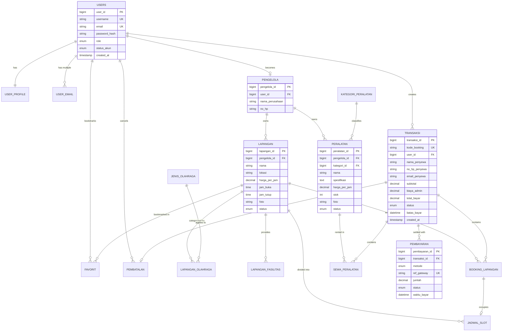

# 🗄️ SIBORA — Database Schema & ERD Documentation

Dokumen ini memuat spesifikasi lengkap skema basis data **SIBORA (Sistem Booking Fasilitas Olahraga Online)**, mencakup Entity Relationship Diagram (ERD), kamus data setiap tabel, relasi antar-tabel, indeks, dan aturan *referential integrity*.

---

## 1. Entity Relationship Diagram (ERD)

---

## 2. Kamus Data (Data Dictionary)

### A. Manajemen Pengguna & Otorisasi

#### 1. Tabel `users`
Tabel akun utama untuk otentikasi sistem.
| Kolom | Tipe Data | Modifiers | Deskripsi |
|---|---|---|---|
| `user_id` | BIGINT UNSIGNED | PK, Auto Increment | Identitas unik pengguna |
| `username` | VARCHAR(60) | UNIQUE, NOT NULL | Nama pengguna untuk login |
| `email` | VARCHAR(190) | UNIQUE, NOT NULL | Alamat email utama |
| `password_hash` | VARCHAR(255) | NOT NULL | Hash password (Bcrypt) |
| `role` | ENUM | DEFAULT 'pelanggan' | Nilai: `pelanggan`, `pengelola`, `admin` |
| `status_akun` | ENUM | DEFAULT 'aktif' | Nilai: `aktif`, `nonaktif` |
| `created_at` | TIMESTAMP | DEFAULT CURRENT_TIMESTAMP | Waktu registrasi |

#### 2. Tabel `user_profile`
Menyimpan informasi personal profil akun.
| Kolom | Tipe Data | Modifiers | Deskripsi |
|---|---|---|---|
| `profile_id` | BIGINT UNSIGNED | PK, Auto Increment | ID profil |
| `user_id` | BIGINT UNSIGNED | UNIQUE, FK $\rightarrow$ `users(user_id)` ON DELETE CASCADE | ID user pemilik profil |
| `nama_lengkap` | VARCHAR(120) | NULLABLE | Nama lengkap pengguna |
| `nickname` | VARCHAR(60) | NULLABLE | Nama panggilan |
| `gender` | VARCHAR(30) | NULLABLE | Jenis kelamin |
| `negara` | VARCHAR(80) | NULLABLE | Negara domisili |
| `bahasa` | VARCHAR(50) | NULLABLE | Preferensi bahasa |
| `zona_waktu` | VARCHAR(60) | NULLABLE | Zona waktu (misal: Asia/Makassar) |
| `no_hp` | VARCHAR(30) | NULLABLE | Nomor telepon/WhatsApp |
| `foto_profil` | VARCHAR(255) | NULLABLE | Path gambar avatar |

#### 3. Tabel `user_email`
Mendukung multi-email per akun untuk verifikasi.
| Kolom | Tipe Data | Modifiers | Deskripsi |
|---|---|---|---|
| `email_id` | BIGINT UNSIGNED | PK, Auto Increment | ID record email |
| `user_id` | BIGINT UNSIGNED | FK $\rightarrow$ `users(user_id)` ON DELETE CASCADE | ID user |
| `email` | VARCHAR(190) | UNIQUE, NOT NULL | Alamat email terdaftar |
| `is_primary` | BOOLEAN | DEFAULT FALSE | Status email primer |
| `created_at` | TIMESTAMP | DEFAULT CURRENT_TIMESTAMP | Waktu ditambahkan |

#### 4. Tabel `pengelola`
Detail entitas bisnis pengelola lapangan.
| Kolom | Tipe Data | Modifiers | Deskripsi |
|---|---|---|---|
| `pengelola_id` | BIGINT UNSIGNED | PK, Auto Increment | ID pengelola |
| `user_id` | BIGINT UNSIGNED | UNIQUE, FK $\rightarrow$ `users(user_id)` ON DELETE CASCADE | ID akun user penanggung jawab |
| `nama_perusahaan` | VARCHAR(150) | NOT NULL | Nama badan usaha / venue arena |
| `no_hp` | VARCHAR(30) | NULLABLE | Kontak resmi bisnis |

---

### B. Katalog Fasilitas Olahraga & Peralatan

#### 5. Tabel `jenis_olahraga`
Daftar cabang olahraga (Futsal, Badminton, Basket, dll).
| Kolom | Tipe Data | Modifiers | Deskripsi |
|---|---|---|---|
| `jenis_olahraga_id` | BIGINT UNSIGNED | PK, Auto Increment | ID cabang olahraga |
| `nama` | VARCHAR(80) | UNIQUE, NOT NULL | Nama cabang olahraga |

#### 6. Tabel `lapangan`
Katalog lapangan yang tersedia untuk disewa.
| Kolom | Tipe Data | Modifiers | Deskripsi |
|---|---|---|---|
| `lapangan_id` | BIGINT UNSIGNED | PK, Auto Increment | ID lapangan |
| `pengelola_id` | BIGINT UNSIGNED | FK $\rightarrow$ `pengelola(pengelola_id)` ON DELETE RESTRICT | Pemilik/pengelola lapangan |
| `nama` | VARCHAR(150) | NOT NULL | Nama lapangan |
| `lokasi` | VARCHAR(255) | NOT NULL | Alamat / lokasi fisik |
| `harga_per_jam` | DECIMAL(12,2) | NOT NULL | Tarif sewa per jam |
| `jam_buka` | TIME | NOT NULL | Jam operasional buka |
| `jam_tutup` | TIME | NOT NULL | Jam operasional tutup |
| `foto` | VARCHAR(255) | NULLABLE | Path gambar lapangan |
| `status` | ENUM | DEFAULT 'aktif' | Nilai: `aktif`, `nonaktif` |

#### 7. Tabel `lapangan_olahraga` (Pivot)
Relasi *Many-to-Many* antara lapangan dan jenis olahraga.
- `lapangan_id` (FK $\rightarrow$ `lapangan`, PK)
- `jenis_olahraga_id` (FK $\rightarrow$ `jenis_olahraga`, PK)

#### 8. Tabel `lapangan_fasilitas`
Fasilitas pendukung di lapangan (Toilet, Parkir, Kantin, WiFi, dll).
- `fasilitas_id` (PK)
- `lapangan_id` (FK $\rightarrow$ `lapangan` ON DELETE CASCADE)
- `nama_fasilitas` (VARCHAR(120), UNIQUE per `lapangan_id`)

#### 9. Tabel `kategori_peralatan` & `peralatan`
Katalog alat olahraga yang dapat disewa (Bola, Raket, Sepatu, dll).
- `peralatan_id` (PK)
- `pengelola_id` (FK $\rightarrow$ `pengelola`)
- `kategori_id` (FK $\rightarrow$ `kategori_peralatan`)
- `nama`, `spesifikasi`, `harga_per_jam`, `stok`, `foto`, `status`

---

### C. Transaksi, Reservasi & Pembayaran

#### 10. Tabel `transaksi`
Header transaksi induk untuk pemesanan lapangan dan alat.
| Kolom | Tipe Data | Modifiers | Deskripsi |
|---|---|---|---|
| `transaksi_id` | BIGINT UNSIGNED | PK, Auto Increment | ID transaksi |
| `kode_booking` | VARCHAR(40) | UNIQUE, NOT NULL | Kode referensi publik (misal: SBR-20261018-XXXX) |
| `user_id` | BIGINT UNSIGNED | FK $\rightarrow$ `users(user_id)` ON DELETE RESTRICT | Akun pelanggan pemesan |
| `nama_penyewa` | VARCHAR(120) | NOT NULL | Nama penanggung jawab |
| `no_hp_penyewa` | VARCHAR(30) | NOT NULL | Kontak penanggung jawab |
| `email_penyewa` | VARCHAR(190) | NOT NULL | Email penerima invoice |
| `subtotal` | DECIMAL(12,2) | NOT NULL | Total biaya sewa murni |
| `biaya_admin` | DECIMAL(12,2) | DEFAULT 0 | Potongan administrasi platform |
| `total_bayar` | DECIMAL(12,2) | NOT NULL | Subtotal + Biaya Admin |
| `status` | ENUM | DEFAULT 'menunggu_pembayaran' | Nilai: `menunggu_pembayaran`, `dp`, `lunas`, `batal`, `kedaluwarsa` |
| `batas_bayar` | DATETIME | NULLABLE | Tenggat waktu pembayaran |
| `created_at` | TIMESTAMP | DEFAULT CURRENT_TIMESTAMP | Waktu checkout |

#### 11. Tabel `booking_lapangan` & `sewa_peralatan`
Detail item reservasi yang terhubung ke `transaksi_id`.
- `booking_lapangan`: merekam `lapangan_id`, `tanggal`, `jam_mulai`, `jam_selesai`, `durasi_jam`, `harga_per_jam`, `subtotal`.
- `sewa_peralatan`: merekam `peralatan_id`, `jumlah`, `tanggal_sewa`, `waktu_mulai`, `waktu_selesai`, `durasi_jam`, `subtotal`.

#### 12. Tabel `jadwal_slot`
Menyimpan status pemesanan per blok jam untuk mencegah bentrok jadwal.
- `slot_id` (PK)
- `lapangan_id` (FK $\rightarrow$ `lapangan`)
- `booking_id` (FK $\rightarrow$ `booking_lapangan` ON DELETE SET NULL)
- `tanggal`, `jam_mulai`, `jam_selesai`
- `status` (`tersedia`, `dipesan`, `dibatalkan`)

#### 13. Tabel `pembayaran` & `pembatalan`
- `pembayaran`: merekam riwayat pelunasan (`metode`, `ref_gateway`, `jumlah`, `status`, `waktu_bayar`).
- `pembatalan`: merekam audit pembatalan transaksi (`dibatalkan_oleh`, `alasan`, `status_refund`, `jumlah_refund`).

---

## 3. Strategi Indexing & Performa

Untuk menjamin eksekusi query tetap instan saat jumlah data membesar:
- `lapangan`: Index komposit `['status', 'nama']` untuk filter katalog cepat.
- `transaksi`: Index komposit `['user_id', 'status']` dan index `created_at` untuk pencarian riwayat dan laporan bulanan.
- `jadwal_slot`: Index komposit `['lapangan_id', 'tanggal', 'status']` untuk pengecekan slot kosong secara instan.
- `booking_lapangan`: Index komposit `['lapangan_id', 'tanggal', 'jam_mulai', 'jam_selesai']` untuk validasi anti-tabrakan jadwal.
